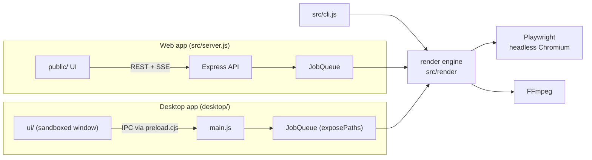
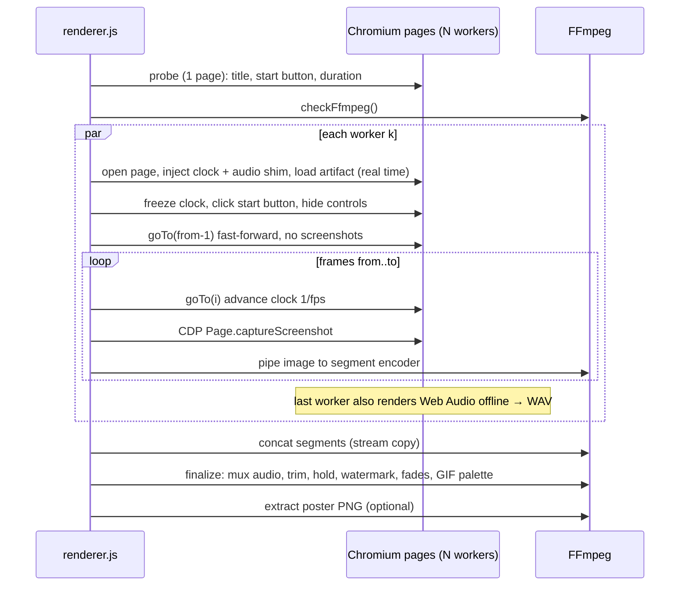

# Architecture

## Context and goals

HTML artifacts are animations that run in a browser: GSAP timelines, CSS animations, canvas loops, Web Audio soundtracks. The goal is to turn them into normal video files with:

- **Frame-exact timing:** every frame at exactly `i / fps` seconds, with nothing dropped, regardless of how slow the machine is.
- **Sample-exact sound:** the soundtrack lines up with the picture.
- **Browser fidelity:** it looks exactly as it does in Chrome.
- **One engine, two products:** a hosted web app and a Windows desktop app produce identical output.

Screen recording fails the first two goals: a slow machine drops frames and real-time audio drifts. So the engine **controls time itself**.

## Components



| Path | Role |
|---|---|
| `src/render/renderer.js` | Probe, render orchestration, browser lifecycle, network guard, worker split |
| `src/render/inject.js` | Script injected before the artifact's own scripts: virtual clock, audio shim, media log |
| `src/render/encode.js` | FFmpeg: frame pipe, `finalize()` filter graph, poster extraction, `checkFfmpeg()` |
| `src/render/presets.js` | Formats, resolutions, aspects, presets, limits, and `normalizeOptions()`, the single validator for user options |
| `src/jobs.js` | In-memory job queue (concurrency, timeouts, cancel, cleanup, public view of a job) |
| `src/server.js` | Web API, uploads, rate limits, owner cookie, housekeeping |
| `src/cli.js` | Command-line front end |
| `public/` | Web UI (plain HTML/CSS/JS). `finishing.js` (finishing panels + output timeline), `base.css` (design system) and `fonts/` are shared with the desktop UI |
| `desktop/main.js` | Electron main process: settings, IPC, queue, notifications, system check, log file |
| `desktop/engine/`, `desktop/ui/finishing.js`, `desktop/ui/base.css`, `desktop/ui/fonts/` | **Generated** copies made by `npm run sync`. Never edit them |

## How a render works



1. **Probe.** One low-resolution page opens the artifact and reads `<meta name="a2v:*">` hints, finds a start button (scored by text such as "play" / "start", favouring "sound", penalising "mute" and control bars) and detects the length. Length sources, in order: `a2v:duration` meta, `window.A2V_DURATION`, `window.film.duration()` (GSAP), the GSAP global timeline, a length constant in an inline script (`const DUR = 30`, `DURATION_MS = 30000` …, 1–600 s), CSS/WAAPI animations and media durations. UI probes also produce a preview JPEG.
2. **Plan.** `normalizeOptions()` has already validated the options. The renderer computes the trim range in frames (`startFrame … endFrame`), the output size, and the worker split: `min(RENDER_WORKERS, frames / 45)` contiguous frame ranges.
3. **Load.** Each worker gets a fresh browser context at the base viewport (for example 1920×1080) with `deviceScaleFactor = outputWidth / baseWidth`. The artifact loads in **real time** so fonts, CDN scripts and audio pre-renders behave normally.
4. **Start.** The clock is frozen. In click mode the start button is clicked once it's enabled ("Preparing sound…" → "Play with sound"); in autoplay mode the clock is frozen from the very first script. Controls and the start button are hidden.
5. **Capture.** The worker fast-forwards (cheap, with no screenshots) to its first frame, then for each frame advances the clock and takes a CDP screenshot (JPEG q94, or PNG for High quality / ProRes / GIF). Images are piped into an FFmpeg process. Writes are pipelined, so FFmpeg encodes frame *i* while Chromium draws frame *i + 1*.
6. **Sound.** The last worker keeps playing to `endFrame + hold`, then renders every shimmed AudioContext offline and mixes them into a WAV. `<audio>` / `<video>` playback is logged (time, offset, volume, loop) and mixed by FFmpeg.
7. **Finalize.** Segments are concatenated with stream copy. `finalize()` builds one FFmpeg filter graph for everything else (below).
8. **Poster.** Optionally, one frame is extracted from the final file. For GIFs it comes from the clean intermediate instead.

## The virtual clock (`inject.js`)

Injected with `addInitScript`, so it runs before any of the artifact's code. It replaces:

- `performance.now`, `Date`, `Date.now`
- `requestAnimationFrame` / `cancelAnimationFrame`
- `setTimeout` / `setInterval` (and the clear functions)
- CSS animations and Web Animations (re-synced to the virtual time on every step)
- `<video>` / `<audio>` current time
- `Math.random`, seeded per artifact, so every worker sees identical "random" values

While the page loads, time runs normally. After `freeze()`, time only moves when the renderer calls `goTo(fps, i)`. That steps one frame at a time to `captureStart + i·1000/fps`, running due timers in order and then rAF callbacks. Targets come from the frame index rather than accumulated deltas, so **every worker reaches identical clock values**, which is what makes parallel segments join seamlessly.

**Busy-wait protection:** some scripts spin `while (performance.now() < t)`. With a frozen clock that would never end, so each clock read while frozen nudges time forward by 0.1 µs (reset every frame).

The page-side API is `window.__a2v`: `freeze()`, `startCapture()`, `advance(ms)`, `goTo(fps, i)`, `now()`, `renderAudio()`, `media()`.

## Audio

Every `new AudioContext()` becomes an `OfflineAudioContext` subclass whose `currentTime` follows the virtual clock. Nodes and scheduling work as usual, but nothing plays. At the end, `renderAudio()` renders the graph for exactly `trimSeconds` and returns PCM, which is written as a 48 kHz WAV.

Details that matter:

- **All workers** get the shim, not just the audio owner. Otherwise an audio-clocked player (one that reads `ctx.currentTime` to drive visuals) would run on real time in some workers and drift.
- **Gate gains:** `connect()` goes through gain nodes that the shim opens and closes on the virtual timeline. `disconnect()` therefore silences from that moment on, instead of erasing audio that already "played" earlier in the offline render.
- **Sound off / GIF:** OfflineAudioContexts the page creates itself (for example to pre-render a score) resolve instantly with silence, which saves seconds of setup in every worker.
- The audio owner renders past the clip end when **Hold** is set, so the soundtrack continues under the frozen frame.
- **Custom soundtrack** (`opts.audio`): a user file added in `finalize()`, starting at the video's first frame (`-stream_loop -1` when looping, `atrim` to the total, `volume`). With `mix: 'replace'` the page's audio isn't captured at all (`captureAudio` off, offline audio faked as with sound off), so a replace render costs no audio setup. `probeAudio()` reads a file's length with `ffmpeg -i` (no ffprobe is bundled) and rejects files without an audio stream.

## Finalize (`encode.js`)

When nothing has to change the pixels, segments are encoded straight to the target codec and `finalize()` only muxes the audio (video stream copy).

When something does (**GIF, hold, fades or watermark**), segments are encoded as a near-lossless **intermediate** (x264 ultrafast, CRF 10, or 6 for High; yuv444p). One final pass then builds a filter graph:

```
[0:v] setpts → tpad (hold, clone last frame)
      → overlay watermark (scaled, alpha via colorchannelmixer) → format=yuv444p
      → fade in → fade out
      → GIF: palettegen + paletteuse (sierra2_4a)   |   else: format=yuv420p / yuv422p10le
audio: WAV atrim from clipStart (length clip + hold) + logged media tracks (adelay, volume, loop)
       + custom soundtrack (from 0, loop, volume)
      → amix → apad/atrim to total → afade in/out
```

`format=yuv444p` after the overlay is required: without it the overlay's alpha channel survives into the GIF path and faded frames turn transparent.

Encoder settings by quality (draft / standard / high):

| Format | Settings |
|---|---|
| MP4 | libx264 veryfast / faster / medium, CRF 26 / 20 / 17, yuv420p, `-tune animation` (WebGL: `-tune film`, `aq-mode=3`), `+faststart` |
| WebM | libvpx-vp9 CRF 38 / 31 / 24, cpu-used 8 / 4 / 2, row-mt (WebGL: `-tune-content film`, `-aq-mode 2`) |
| MOV | prores_ks profile 0 / 2 / 3 (Proxy / 422 / 422 HQ), yuv422p10le, PCM audio |
| GIF | palette per video, `stats_mode=diff`, 256 colours, loops forever |

## Resolution model

The page is always laid out at the base viewport for its aspect (16:9 → 1920×1080, 9:16 → 1080×1920, 1:1 → 1080×1080, 4:5 → 1080×1350). The output size is "resolution = short side". Above 1080p the device scale factor rises (4K = DSF 2), so text and vectors are drawn sharper, not upscaled. Below 1080p the page is captured at DSF 1 and FFmpeg downscales with lanczos, which is faster than a scaled screenshot and keeps the layout identical across resolutions.

**Capturing at the right density:** a CDP `Page.captureScreenshot` returns CSS-pixel dimensions (1920×1080) whatever the context's `deviceScaleFactor` is. The engine therefore passes `clip: { …, scale: dsf }` whenever the density isn't 1. Without it, 4K output was 1080p frames enlarged by FFmpeg (fixed 2026-10-11). True 4K costs about 4× the capture time of 1080p. (A supersampling "Sharpness" option was tried and removed: Chromium already antialiases text and shapes, so drawing at 2× and scaling down changed pixels by under 1/255 on average while taking 3.5× as long.)

## Chromium configuration

- Compositor flags `--run-all-compositor-stages-before-draw`, `--disable-low-res-tiling`, `--disable-checker-imaging`, `--disable-partial-raster` ensure every screenshot is fully drawn. Without them, 4K frames were sometimes captured half-rasterised.
- **GPU** is off by default (software rendering is deterministic and works on any VPS). `ENABLE_GPU=1` / the desktop toggle is experimental.
- **WebGL:** headless Chromium (141) falls back to SwiftShader (CPU) WebGL by itself; `ENABLE_WEBGL=1` forces it explicitly. The heavy part is the page's shaders, not the flags: a three.js reel with bloom took ~3 s per screenshot at 1080×1920 and ~0.7 s at 480×854, whatever the compositing flags. So `inject.js` records which canvas contexts a page creates (`__a2v.contexts()`), the probe reports `webgl` / `webglFailed`, the UI warns, and WebGL pages are captured at the output density (`deviceScaleFactor` < 1 below 1080p) instead of at 1080p and downscaled. `ENABLE_GPU=1` (desktop: Use graphics card) is the real fix on machines with a GPU.
- **WebGL encoding:** 3D scenes are photographic: soft light, film grain, dark gradients. `-tune animation` (right for flat UI art) smoothed the grain away and left blocks in dark areas, so WebGL artifacts are captured as PNG and encoded with `content: 'photo'` (`-tune film`, `aq-mode=3`), at roughly twice the bitrate.
- **WebGL fast-forward:** drawing skipped frames (trim start, later workers) queues GPU work without waiting for it, and the first real frame then waited for all of it (it hit the 60 s deadline). Fast-forward runs in chunks of 10 frames with a throwaway screenshot after each to drain the queue.
- One shared browser process; each worker gets its own context (no shared cookies or storage), with service workers, downloads, popups and dialogs blocked.

## Security model

Uploaded HTML is untrusted code.

- **Network guard:** every request goes through a route handler. URLs resolving to loopback, private or link-local addresses are refused (SSRF protection) unless `ALLOW_PRIVATE_NETWORK=1`. The artifact itself is served from a fake origin.
- **Asset mirror:** common CDN files (GSAP and similar) are served from `asset-mirror/` on disk, which is faster and avoids depending on the CDN during a render.
- **Desktop relative assets:** only the desktop app serves `./files` from the artifact's own folder, with a path check that keeps it inside that folder. The web server never does.
- **Web isolation:** jobs and uploads belong to an anonymous `a2v_owner` cookie. Uploads, watermarks, audio files and job creation are rate-limited. Watermarks are checked by magic bytes (PNG / JPEG / WebP), audio files by FFmpeg (`probeAudio`). Every file is deleted after `JOB_TTL_MIN`.
- **No paths from clients:** a watermark or soundtrack is referenced by an upload id (web) or a library id whose path is stored in main-process settings (desktop), never by a path sent from the UI. `JobQueue.public()` strips server paths unless the queue was created with `exposePaths` (desktop only).

## Failure handling

Every step has a deadline (`withTimeout`), so a stuck page or encoder becomes an error that names the worker and the step, for example *"FFmpeg stopped accepting frames at frame 812 (renderer 3, step: frame 812)"*. FFmpeg is verified (`checkFfmpeg()`, including the needed encoder) before capture starts. A dying FFmpeg rejects pending frame writes immediately. One failing worker aborts the others. Jobs have an overall timeout (`JOB_TIMEOUT_MIN`).

## UI layer

Both apps are plain HTML/CSS/JS with no build step. What they share comes from `public/` and is copied into the desktop app by `npm run sync`:

- **`base.css`:** design tokens (studio gray, ink, the green accent `#15DB90`, with `#087447` for green text on light panels) and every shared component: inspector-style fields, switches, collapsible sections, buttons, the output timeline, frame previews and sliders. Each app's `app.css` only lays out its own screens. The Archivo variable font is bundled in `public/fonts/`.
- **`finishing.js` (`createFinishing()`):** the Preset dropdown and the Soundtrack, Trim, Fades & ending, Watermark and Poster image panels. It also owns the output timeline (`drawTimeline()`), the frame previews and the watermark size labels. The host app passes in `previewFrame(seconds)` and `previewKey()`, the soundtrack callbacks (`onAddAudio`, `onRemoveAudio`, `soundState`) and the audio library (`setAudioLibrary()`; the host keeps the files), and calls `drawTimeline(duration, fps)` on every change.

**Frame previews.** The poster preview and the trim's first and last frames are real renders: `previewFrame()` in `renderer.js` opens the artifact with the same seed, start mode and hidden controls as a render (sound off), steps the virtual clock to the frame and takes one 960 px screenshot. The web app reaches it through `POST /api/uploads/:id/frame` (at most `PREVIEW_CONCURRENCY` at once); the desktop app through the `preview-frame` IPC call. In the UI, the three preview slots share one queue: one render at a time, newest request first, requests for hidden panels skipped, and frames cached by key (artifact, aspect, start options, fps, time), so a frame is never rendered twice. A preview costs one page load plus fast-forward, about 5–7 s on 2 vCPU. Fades and the watermark are drawn over the poster preview in CSS, using the encoder's maths (4% margin, width share).

**Per-artifact settings (desktop).** Settings are shared by every artifact in the queue, except `trimStart`, `trimEnd`, `posterTime` and `audio`. `desktop/ui/app.js` keeps shared values plus a map of per-artifact overrides. Selecting a row loads that artifact's values into the Trim, Poster and Soundtrack fields, edits go to its override (dropped again if it matches the shared values), and Convert sends `{ ids, options, perItem }`. `main.js` merges only those four keys per artifact before `normalizeOptions()`, then resolves the soundtrack's library id to a path from `settings.audioFiles` (an error names a missing or moved file before any job starts).

**Form validation is off** (`novalidate` on both forms). The app validates trim and duration itself and shows readable errors. Built-in validation once silently blocked Convert, because a range input's float value (`0.9666666666666667`) exceeded its own `max` string (`0.966666666666667`). Range values are also rounded to milliseconds.

**Desktop window.** `titleBarStyle: 'hidden'` with `titleBarOverlay`: the app header is the title bar (CSS `-webkit-app-region: drag`), and Windows draws its own window buttons over it in colours that follow the theme. The packaged app has no menu bar; a right-click menu (`context-menu` event in `main.js`) provides Copy / Paste / Select all. The System check panel is shown only in development or with `A2V_DEBUG=1`.

## Key decisions and trade-offs

| Decision | Why | Cost |
|---|---|---|
| Virtual clock instead of screen recording | Exact frames and sound at any machine speed | Artifacts that measure real elapsed time some other way (Workers, `MessageChannel` timing) aren't controlled |
| Parallel segments with deterministic replay | Throughput scales with cores | Each worker replays from t = 0 (fast-forward is cheap, but setup is repeated) |
| CDP screenshots (not screencast) | Frame-exact; screencast drops and coalesces frames | About 65 ms per 1080p frame is readback + encode, even for a blank page |
| Offline audio shim | Sample-exact sync | Audio that never goes through Web Audio or media elements (microphone, MediaStream) is missed |
| One intermediate + single finalize pass | Hold, fades, watermark and GIF palette all in one place | An extra encode when post-processing is on (near-lossless, so no visible loss) |
| In-memory queue | Zero dependencies for one VPS | No horizontal scaling; swap `src/jobs.js` for BullMQ + Redis (same create / get / cancel / subscribe surface) |
| Plain HTML/CSS/JS UI, no build step | The same files run in the web app and Electron | No component framework |
| Desktop bundles its own Chromium | Same output as the server, no dependency on the user's browser version | Bigger installer (about 60 MB compressed); Edge / Chrome are fallbacks |

## Performance

The bottleneck is Chromium software rendering plus screenshot readback: about 150 ms per 1080p frame per page for the sample artifact. FFmpeg is a small share. Levers, in order of impact: more workers or cores, fewer frames (fps, trim), GPU (experimental), sound off. Measured on 2 vCPU: the 55 s sample at 1080p30 with sound took about 4.5 minutes.
